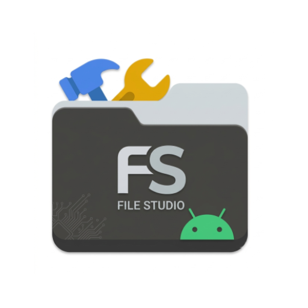
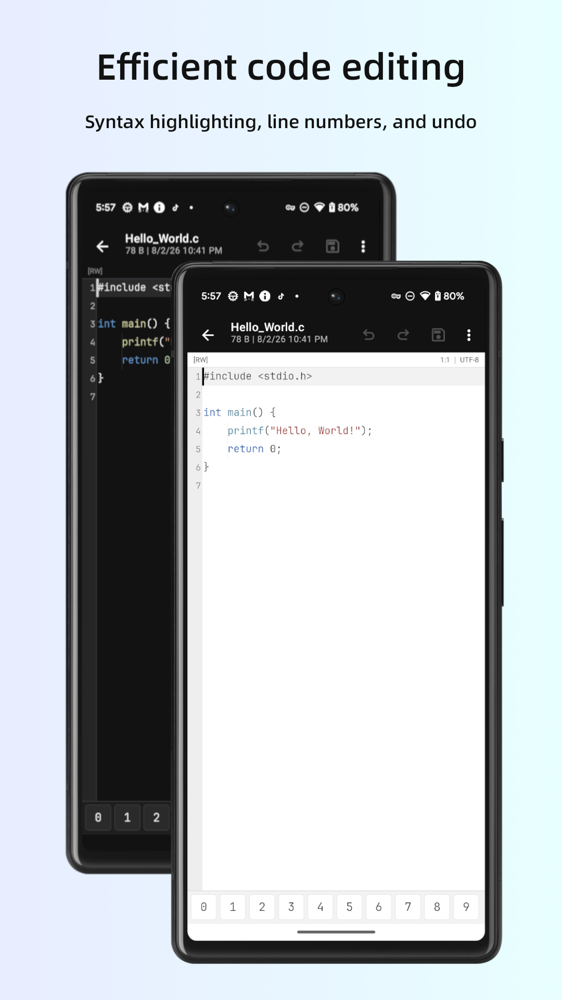
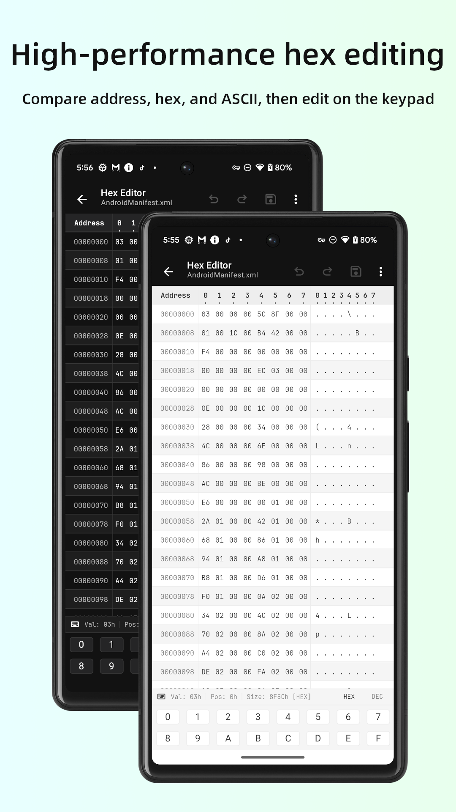
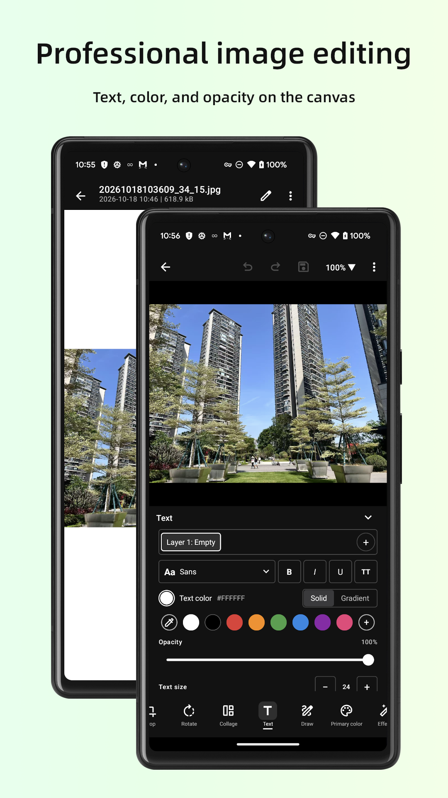
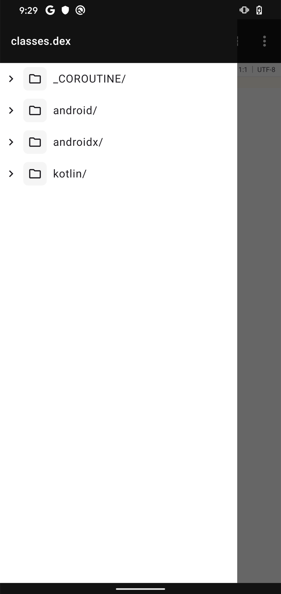
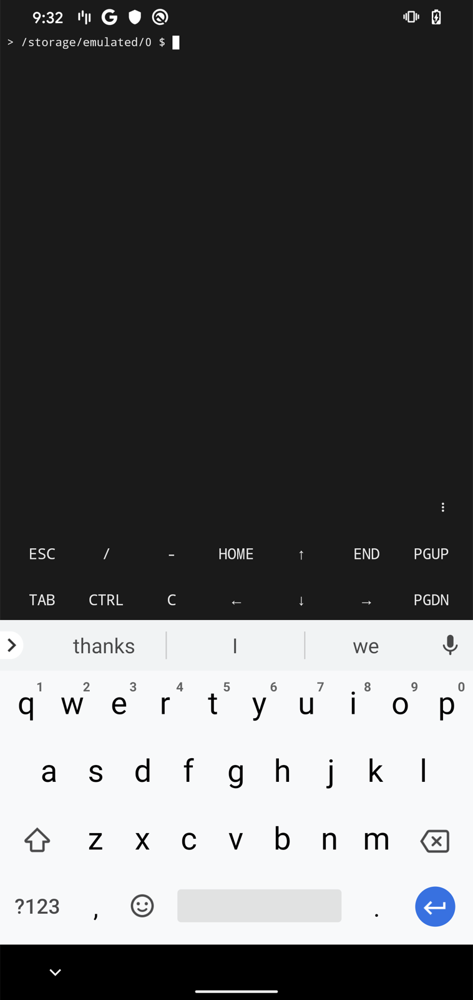
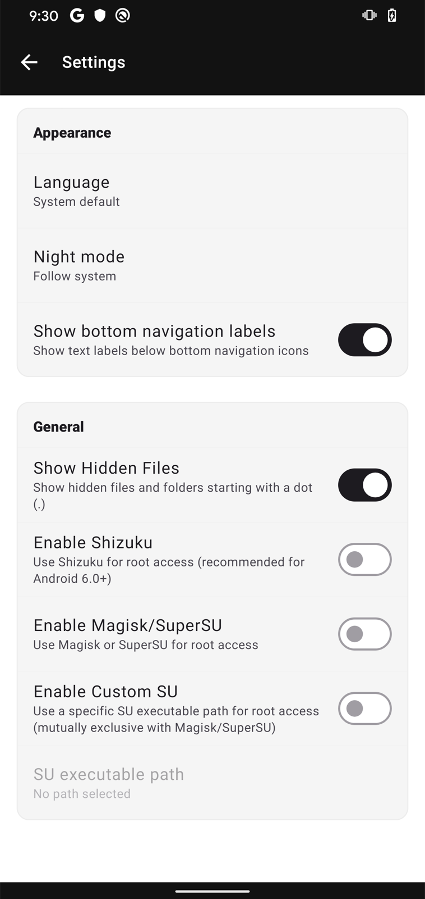

  

<h1 align="center">File Studio</h1>

  <strong>Geek file manager for Android</strong> 
  Born for geeks. A file manager made for tinkerers.

  <a href="README.md">English</a> ·
  <a href="README.zh-CN.md">简体中文</a>

  

  <a href="https://play.google.com/store/apps/details?id=com.happy.explorer">Google Play</a>
  · <a href="https://whalestarglobal.github.io/FileStudio/">Pages</a>
  · <a href="https://fs.xingqux.com">Website</a>

File Studio puts a file explorer, code and hex editors, archive tools, a terminal, and remote access in one Android app. Browse a project, inspect an APK, edit a script, and copy a file to your computer without switching tools.

## One app, six ways

| | | |
| --- | --- | --- |
| **Browse** Tabs, bookmarks, batch operations | **Edit** Syntax-highlighted text and code | **Inspect** Hex, APK, and DEX |
| **Create** Image editing and audio DSP | **Connect** FTP, SFTP, SMB, WebDAV | **Go deeper** Root, Shizuku, terminal, SQLite |

  

<table>
  <tr>
    <td width="50%"></td>
    <td width="50%"></td>
  </tr>
  <tr>
    <td></td>
    <td></td>
  </tr>
</table>

  

## Go deeper

The same file tab also opens tools that usually live in separate apps.

<table>
  <tr>
    <td width="33%" valign="top" align="center">
       
      <b>DEX / APK</b> 
      Open <code>classes*.dex</code>, walk the class tree, read Smali, and preview Java. On Google Play this path is read-only.
    </td>
    <td width="33%" valign="top" align="center">
       
      <b>Terminal</b> 
      Open a session from the folder you are browsing. Extra keys for Esc, Ctrl, arrows, and paging.
    </td>
    <td width="33%" valign="top" align="center">
       
      <b>Root / Shizuku</b> 
      Optional elevated file access via Shizuku, Magisk / SuperSU, or a custom <code>su</code> path.
    </td>
  </tr>
</table>

## Also in the app

- **Archives** — browse ZIP, JAR, APK, and XAPK as folders; extract, search, and open nested files
- **App manager** — installed apps, permissions, components, and APK export
- **Nearby Transfer** — send files to another File Studio device on the same Wi-Fi
- **Recycle bin** — restore items deleted inside the app
- **SQLite** — inspect database files
- **Documents** — view PDFs; professional video tools alongside image and audio editors

Share a folder from this device over FTP, FTPS, SFTP (Android 8+), or WebDAV, and show the address as a QR code. Connect the other way as a client to the same protocols.

## Who it is for

- People who edit scripts, logs, and configs on a phone
- Android developers who need an APK / DEX look when a computer is not around
- Anyone connecting over SFTP, SMB, or WebDAV, or using Shizuku for app data directories
