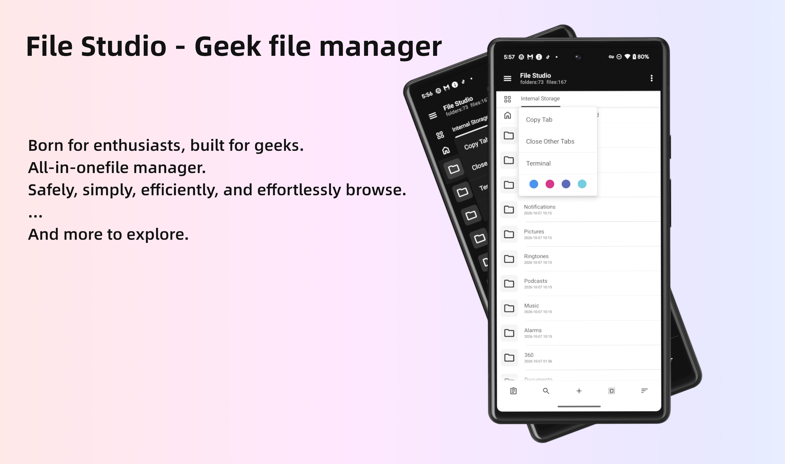
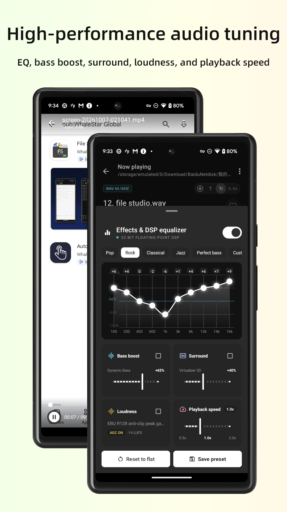
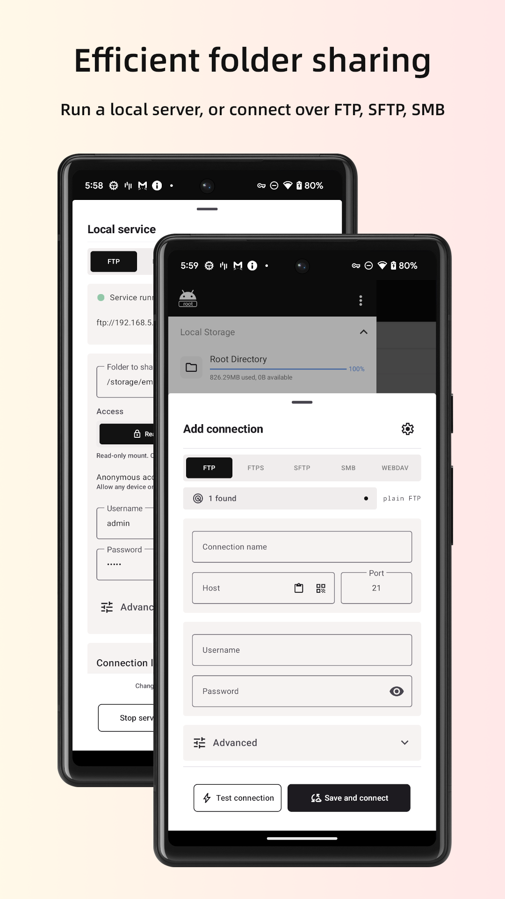

  

<h1 align="center">File Studio</h1>

<strong>File management, editors, and remote access for Android.</strong>

<a href="README.md">English</a> · <a href="README.zh-CN.md">简体中文</a>

<a href="https://whalestarglobal.github.io/FileStudio/">Product page</a> · <a href="https://fs.xingqux.com/">Website</a> · <a href="https://fs.xingqux.com/legal/privacy/">Privacy</a>

File Studio combines a file explorer, built-in editors, APK / DEX inspection, a terminal, and remote connections. Manage files on your device, edit text and binary data, and work with files on your computer or server.

## Download from Google Play

The badge opens the File Studio listing on Google Play.

## Screenshots

<table width="100%">
  <tr>
    <td colspan="5" align="center" valign="top">
       
      File explorer
    </td>
  </tr>
  <tr>
    <td width="20%" align="center" valign="top">
       
      Code
    </td>
    <td width="20%" align="center" valign="top">
       
      Hex
    </td>
    <td width="20%" align="center" valign="top">
       
      Images
    </td>
    <td width="20%" align="center" valign="top">
       
      Audio
    </td>
    <td width="20%" align="center" valign="top">
       
      Sharing
    </td>
  </tr>
</table>

## Features

- **File explorer** — Tabs, bookmarks, multi-select, common file operations, and an in-app recycle bin.
- **Text and code editor** — Edit configs, logs, and scripts with syntax highlighting, search and replace.
- **Hex editor** — View address, hexadecimal, and ASCII side by side, and edit individual bytes.
- **Image editor** — Add text and adjust color and opacity on the editing canvas.
- **Audio player** — Control EQ, bass boost, surround, loudness, and playback speed.
- **Folder sharing** — Share folders over FTP, FTPS, SFTP, or WebDAV, and display the address as a QR code.

### More file tools

- **Remote connections** — Connect to FTP, FTPS, SFTP, SMB, and WebDAV servers to browse and manage remote files.
- **Archives** — Open ZIP, APK, and XAPK archives; extract, search, and view their contents.
- **APK / DEX inspector** — Browse a class tree, read Smali, and preview Java. [View screenshot](docs/images/screenshots/shared/apk-dex.png).
- **Terminal** — Open built-in terminal sessions for command-line tasks. [View screenshot](docs/images/screenshots/shared/terminal.png).
- **Root / Shizuku** — Use your device’s existing Root or Shizuku setup for elevated file access. [View screenshot](docs/images/screenshots/shared/root-shizuku.png).
- **App manager** — Browse installed apps, inspect permissions and components, open storage locations, and export APKs.
- **Nearby Transfer** — Send files to another File Studio device on the same Wi-Fi network, using device selection, an address, or a QR code.
- **Database browser** — Browse SQLite database files.
- **Documents and video** — View PDFs and use the built-in video playback tools.

## Availability

- Some advanced tools require a subscription.
- Smali and Java previews opened through APK / DEX are read-only in the Google Play edition.
- Access to protected locations depends on Android permissions and your Root or Shizuku setup.
- Local SFTP folder sharing requires Android 8 or later. FTP, FTPS, and WebDAV are also available for folder sharing.

## Contact

- **Email**: [jingyouxingqu@gmail.com](mailto:jingyouxingqu@gmail.com)
- **X**: [@geekfilestudio](https://x.com/geekfilestudio?s=11)
- **Telegram Boost**: [Telegram Boost](https://t.me/boost?c=3810486807)
