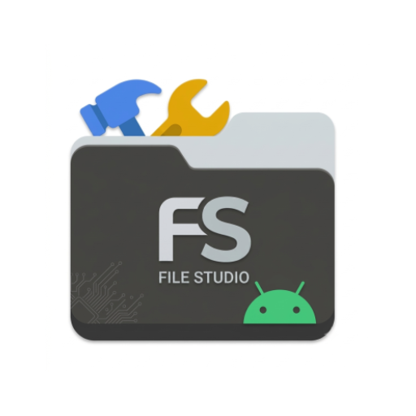
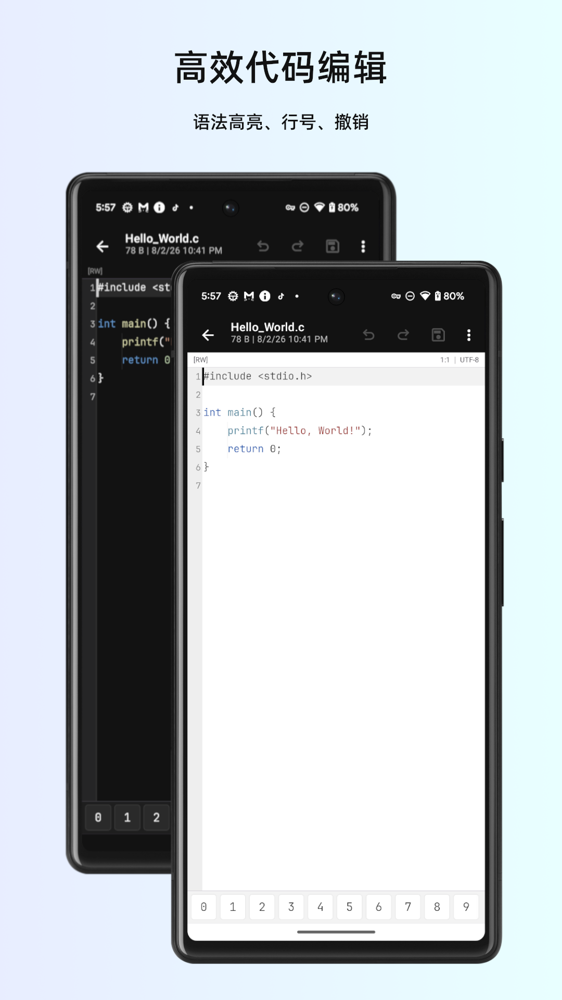
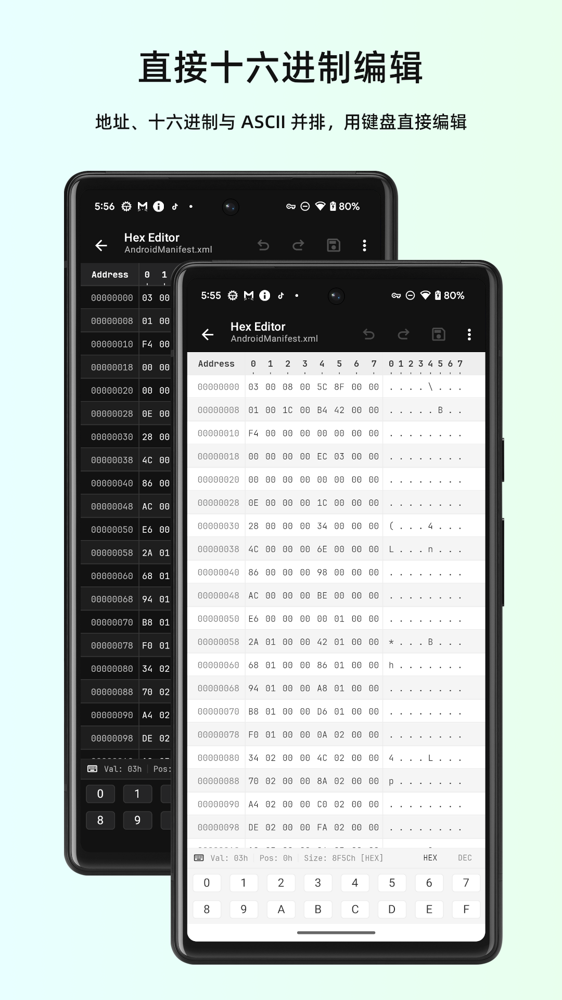
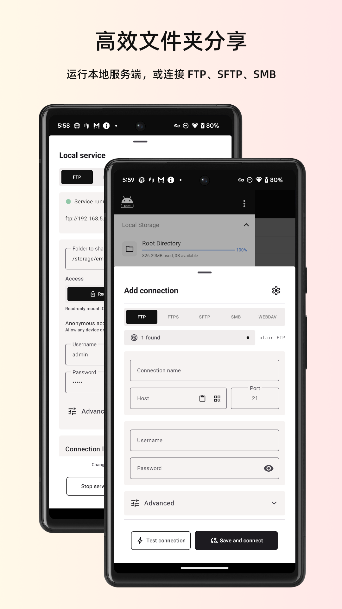

  

<h1 align="center">File Studio</h1>

<strong>你的文件， 你的工作台。</strong>

<a href="README.md">English</a> · <a href="README.zh-CN.md">简体中文</a>

<a href="https://whalestarglobal.github.io/FileStudio/zh-cn/">应用介绍</a> · <a href="https://fs.xingqux.com/zh-cn/">官网</a>

File Studio 把文件管理、代码编辑、APK 查看、终端和远程访问放进同一个 Android 工作台。打开目录，就能接着完成手头的事。

## 现在，你想做什么？

### 找到文件，接着做事。

用标签页和书签留住常用目录，批量复制、移动、重命名。误删的文件，也可以从应用内回收站找回。

### 想改的地方，随手就改。

调整配置、修改脚本、阅读日志。语法高亮、查找替换和撤销，让手机上的每一次修改更顺手。

### 打开文件，再看深一点。

浏览 ZIP 压缩包，核对十六进制数据，或展开 APK 中的 DEX 类树。需要了解代码时，还能阅读 Smali、预览 Java。

### 手机之外，也触手可及。

通过 FTP、FTPS、SFTP、SMB 或 WebDAV 连接电脑和服务器。也能在局域网分享文件夹，或向同一 Wi-Fi 下的另一台 File Studio 传送文件。

## 用得上时，就在手边。

- **终端** — 从当前目录打开会话，用 Esc、Ctrl 和方向键等快捷键继续操作。
- **Root 与 Shizuku** — 按需使用设备已有的授权方式，访问需要更高权限的文件。
- **SQLite 与应用管理** — 查看数据库、了解应用权限与组件，导出已安装应用的 APK。
- **媒体与文档** — 查看 PDF、编辑图片、调节音频播放，让文件处理多几种可能。

## 应用截图

<table width="100%">
  <tr>
    <td colspan="5" align="center" valign="top">
       
      文件浏览
    </td>
  </tr>
  <tr>
    <td width="20%" align="center" valign="top">
       
      代码编辑
    </td>
    <td width="20%" align="center" valign="top">
       
      十六进制编辑
    </td>
    <td width="20%" align="center" valign="top">
       
      图片编辑
    </td>
    <td width="20%" align="center" valign="top">
       
      音频播放
    </td>
    <td width="20%" align="center" valign="top">
       
      文件夹分享
    </td>
  </tr>
</table>

## 开始之前

- 部分高级工具需要订阅。
- Google Play 版通过 APK / DEX 打开的 Smali 与 Java 预览为只读。
- 访问受保护目录取决于 Android 权限，以及设备已有的 Root 或 Shizuku 授权。
- 本机文件夹分享支持 FTP、FTPS、SFTP（Android 8 及以上）和 WebDAV；附近传输用于同一 Wi-Fi 下的 File Studio 设备。

## 开始使用 File Studio

了解应用、下载安装，或把使用反馈告诉我们。

[官网](https://fs.xingqux.com/zh-cn/) · [隐私政策](https://fs.xingqux.com/zh-cn/legal/privacy/) · [Email](mailto:jingyouxingqu@gmail.com)

[X (@geekfilestudio)](https://x.com/geekfilestudio?s=11) · [Telegram 助力](https://t.me/boost?c=3810486807)
