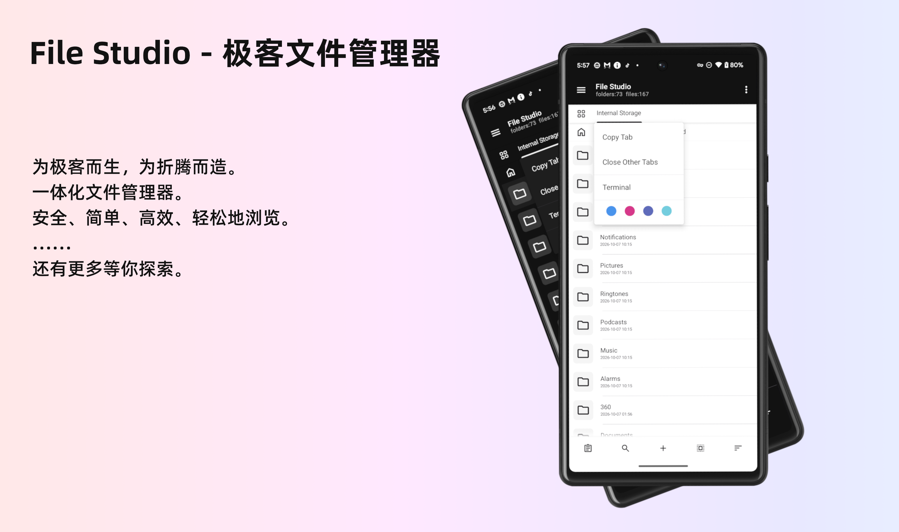
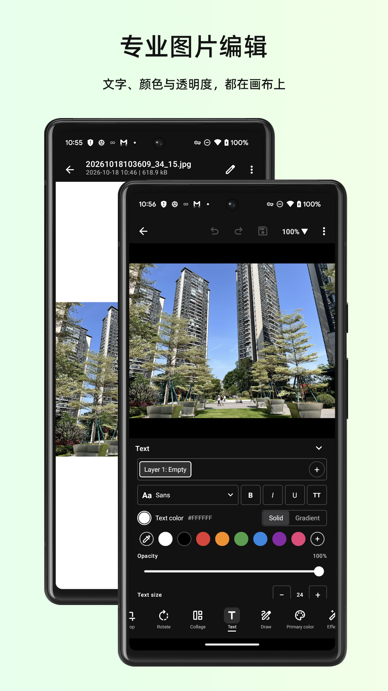
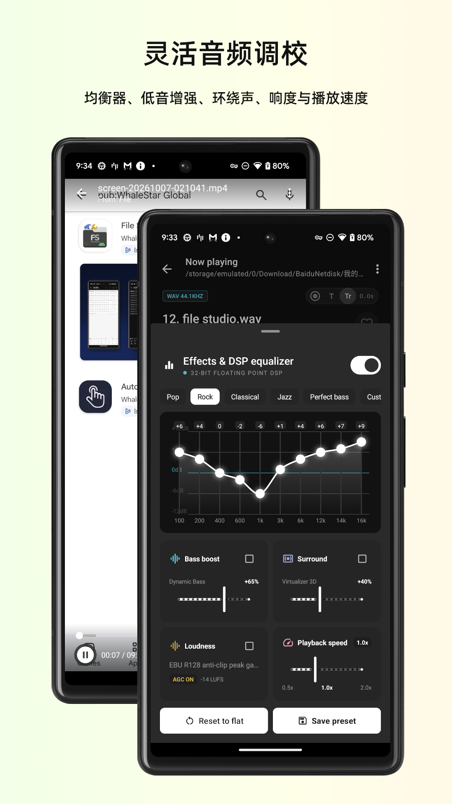

  

<h1 align="center">File Studio</h1>

<strong>Android 文件管理、编辑与远程连接工具。</strong>

<a href="README.md">English</a> · <a href="README.zh-CN.md">简体中文</a>

<a href="https://whalestarglobal.github.io/FileStudio/zh-cn/">应用介绍</a> · <a href="https://fs.xingqux.com/zh-cn/">官网</a> · <a href="https://fs.xingqux.com/zh-cn/legal/privacy/">隐私政策</a>

File Studio 集成文件浏览、内置编辑器、APK / DEX 查看、终端和远程连接。在手机上整理文件、修改文本与二进制数据，也能连接电脑和服务器处理远程文件。

## 从 Google Play 下载

点击徽章，前往 File Studio 的 Google Play 商店页面。

## 应用截图

<table width="100%">
  <tr>
    <td colspan="5" align="center" valign="top">
       
      文件浏览
    </td>
  </tr>
  <tr>
    <td width="20%" align="center" valign="top">
       
      代码
    </td>
    <td width="20%" align="center" valign="top">
       
      十六进制
    </td>
    <td width="20%" align="center" valign="top">
       
      图片
    </td>
    <td width="20%" align="center" valign="top">
       
      音频
    </td>
    <td width="20%" align="center" valign="top">
       
      分享
    </td>
  </tr>
</table>

## 功能介绍

- **文件浏览与管理** — 标签页、书签、多选与常用文件操作，通过回收站恢复应用内删除的项目。
- **文本与代码编辑** — 编辑配置、日志和脚本，支持语法高亮、查找与替换。
- **十六进制编辑** — 并排查看地址、十六进制与 ASCII，支持编辑单个字节。
- **图片编辑** — 在画布上添加文字，调整颜色和透明度。
- **音频播放** — 支持均衡器、低音增强、环绕声、响度和播放速度调节。
- **文件夹分享** — 通过 FTP、FTPS、SFTP 或 WebDAV 分享目录，并用二维码展示地址。

### 更多文件工具

- **远程连接** — 连接 FTP、FTPS、SFTP、SMB 和 WebDAV 服务器，浏览和管理远程文件。
- **压缩包** — 打开 ZIP、APK、XAPK，解压、搜索和查看其中的内容。
- **APK / DEX 查看** — 浏览类树、阅读 Smali、预览 Java。[查看截图](docs/images/screenshots/shared/apk-dex.png)。
- **终端** — 使用内置终端会话执行命令行操作。[查看截图](docs/images/screenshots/shared/terminal.png)。
- **Root / Shizuku** — 使用设备已有的 Root 或 Shizuku 授权，访问需要更高权限的文件。[查看截图](docs/images/screenshots/shared/root-shizuku.png)。
- **应用管理** — 浏览已安装应用，查看权限与组件、打开存储位置，并导出 APK。
- **附近传输** — 向同一 Wi-Fi 下的另一台 File Studio 传送文件，可选择设备、填写地址或扫描二维码。
- **数据库浏览** — 浏览 SQLite 数据库文件。
- **文档与视频** — 查看 PDF，并使用内置的视频播放工具。

## 功能说明

- 部分高级工具需要订阅。
- Google Play 版通过 APK / DEX 打开的 Smali 与 Java 预览为只读。
- 访问受保护目录取决于 Android 权限，以及设备已有的 Root 或 Shizuku 授权。
- 本机 SFTP 文件夹分享需要 Android 8 或更高版本；也可使用 FTP、FTPS 或 WebDAV 分享文件夹。

## 联系方式

- **Email**: [jingyouxingqu@gmail.com](mailto:jingyouxingqu@gmail.com)
- **X**: [@geekfilestudio](https://x.com/geekfilestudio?s=11)
- **Telegram 助力**: [Telegram 助力](https://t.me/boost?c=3810486807)
