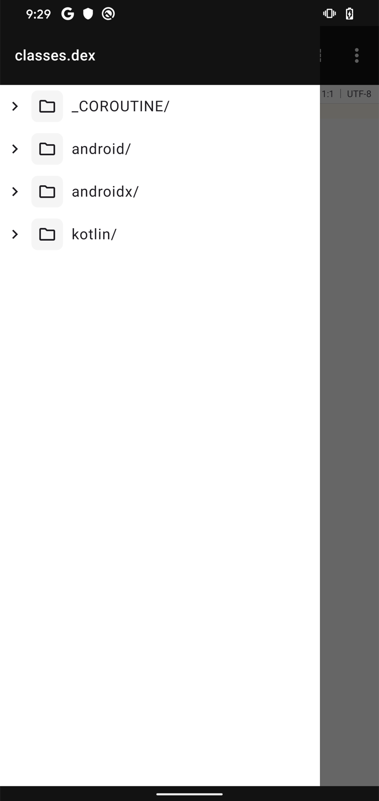
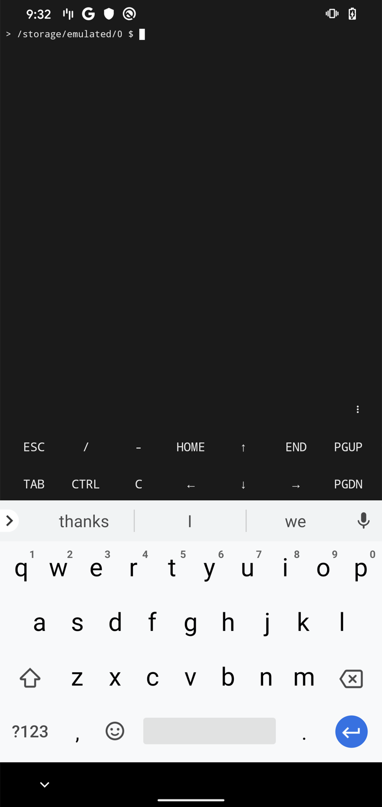

  

<h1 align="center">File Studio</h1>

  <strong>极客文件管理器</strong> 
  为极客而生。为喜欢折腾的用户打造的文件管理器。

  <a href="README.md">English</a> ·
  <a href="README.zh-CN.md">简体中文</a>

  

  <a href="https://play.google.com/store/apps/details?id=com.happy.explorer">Google Play</a>
  · <a href="https://whalestarglobal.github.io/FileStudio/zh-cn/">预览页</a>
  · <a href="https://fs.xingqux.com/zh-cn/">官网</a>

在 Android 上完成程序员平时要换好几款工具才能做的事：浏览工程目录、改源码、看二进制、拆开 APK 里的 DEX、开一个终端，再连回自己的电脑或服务器。

## 一个应用，六种用法

| | | |
| --- | --- | --- |
| **浏览** 标签页、书签、批量操作 | **编辑** 带语法高亮的文本与代码 | **查看** 十六进制、APK 与 DEX |
| **创作** 图片编辑与音频 DSP | **连接** FTP、SFTP、SMB、WebDAV | **深入** Root、Shizuku、终端、SQLite |

  

<table>
  <tr>
    <td width="50%"></td>
    <td width="50%"></td>
  </tr>
  <tr>
    <td></td>
    <td></td>
  </tr>
</table>

  

## 再往里看

同一个文件标签页里，还能打开通常要另装应用才有的工具。

<table>
  <tr>
    <td width="33%" valign="top" align="center">
       
      <b>DEX / APK</b> 
      从 APK 打开 <code>classes*.dex</code>，按包名浏览类树，阅读 Smali，并打开 Java 预览。Google Play 渠道下这条路径是只读的。
    </td>
    <td width="33%" valign="top" align="center">
       
      <b>终端</b> 
      从当前浏览的目录打开会话。快捷栏提供 Esc、Ctrl、方向键和翻页。
    </td>
    <td width="33%" valign="top" align="center">
       
      <b>Root / Shizuku</b> 
      可选。设备已有 Shizuku、Magisk / SuperSU 或自定义 <code>su</code> 时，再打开更高权限的文件访问。
    </td>
  </tr>
</table>

## 另外还有

- **压缩包** — 把 ZIP、JAR、APK、XAPK 当目录浏览；解压、搜索、打开里面的文件
- **应用管理** — 已安装应用、权限、组件，以及导出 APK
- **附近传输** — 把文件发到同一 Wi-Fi 上的另一台 File Studio
- **回收站** — 恢复在应用内删除的项目
- **SQLite** — 查看数据库文件
- **文档与媒体** — 查看 PDF；图片、音频之外还有专业视频工具

也可以从本机分享文件夹：FTP、FTPS、SFTP（Android 8 及以上）或 WebDAV，并用二维码显示地址。反过来作为客户端，连接同一组协议。

## 适合谁

- 在手机上改脚本、看日志、核对配置的人
- 要在没有电脑时看 APK 结构、DEX 类树和 Smali 的 Android 开发者
- 需要 SFTP / SMB / WebDAV 连到自己的机器，或用 Shizuku 访问应用数据目录的人
